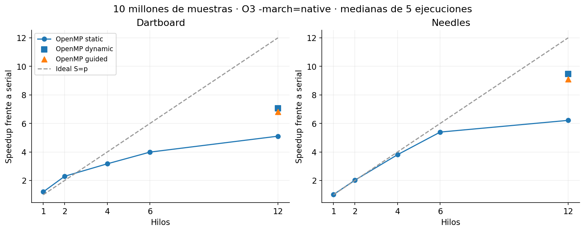
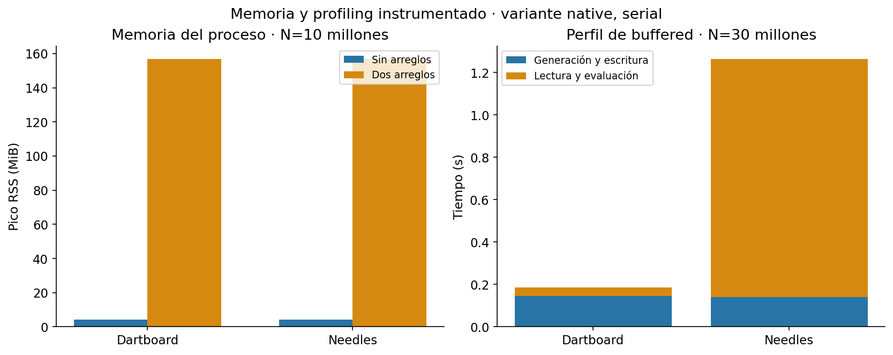

# Cálculo de π por Monte Carlo: análisis, OpenMP y desempeño

Fecha: 4 de noviembre de 2026. Mediciones realizadas en el equipo local.

## 1. Verificación de las implementaciones seriales originales

Se revisaron `Needle.c` y `Dartboard.c`, se recompilaron sus fuentes con GCC
usando `-std=c11 -O2 -Wall -Wextra -Wpedantic`, y se ejecutaron los binarios
nuevos. Se verificaron las fuentes, no solamente los `.exe` preexistentes.
No hubo advertencias de compilación. Los originales se conservaron sin cambios.

Ambos son seriales: el cálculo se realiza en un único `for`, sin directivas
OpenMP, creación de hilos ni tareas. Se compilaron sin `-fopenmp`.
`rand()` y los contadores se utilizan desde ese único flujo de ejecución.

La ejecución guardada en `resultados/verificacion.json` produjo:

| Algoritmo original | N | Aciertos/cruces | π aproximado | Tiempo impreso |
|---|---:|---:|---:|---:|
| Needles | 1 000 000 | 636 223 | 3,1435518678 | 0,063 s |
| Dartboard | 1 000 000 | 785 356 | 3,1414240000 | 0,024 s |

Las aproximaciones están dentro de una tolerancia estadística de seis errores
estándar respecto de π. Esto es una comprobación de coherencia, junto con el
análisis de las fórmulas; una ejecución aislada no demuestra por sí sola la
calidad estadística del generador. Las ejecuciones anteriores dieron otros
valores porque los originales usan `srand(time(NULL))`.

Aspectos que conviene mejorar para experimentar: N está fijo, la semilla cambia
según la hora, no se informan incertidumbre ni memoria, y `clock()` no proporciona
una medición de tiempo transcurrido portable para comparar paralelismo. No se
encontró un error matemático en los originales con sus parámetros actuales.

## 2. Fundamento de los algoritmos

### 2.1 Dartboard

Se generan puntos uniformes `(x,y)` en el cuadrado `[-1,1] × [-1,1]`. El punto
pertenece al disco si `x²+y² <= 1`. Como la razón entre las áreas es `π/4`,
si H es el número de puntos dentro del círculo:

```text
p = π/4
p_estimado = H/N
π_estimado = 4H/N
```

Esta es precisamente la fórmula del original. Evitar la raíz cuadrada permite
clasificar el punto con multiplicaciones y una suma. Su costo temporal es O(N)
y su memoria auxiliar serial es O(1).

### 2.2 Needles o aguja de Buffon

Se consideran líneas paralelas separadas una distancia D y agujas de longitud L,
con `0 < L <= D`. Por simetría se generan la distancia del centro a la línea
más cercana `d ~ U[0,D/2]` y el ángulo `θ ~ U[0,π/2]`. La aguja cruza cuando
`d <= (L/2) sin(θ)`. Integrando esa condición:

```text
p_cruce = (2/π) ∫[0,π/2] (L/D) sin(θ) dθ = 2L/(πD)
π_estimado = 2LN/(D C), con C > 0 cruces
```

El original usa L=D=1 y aplica correctamente la condición y el estimador. Si
L>D, esta fórmula debe sustituirse por la del caso de agujas largas. Si C=0,
el estimador no está definido; el original avisa que no puede calcularlo y la
versión nueva lo representa como `nan` en el CSV.

Esta formulación usa una constante π conocida para generar el ángulo uniforme.
Es habitual como ejercicio de Monte Carlo, aunque no constituye una manera
independiente de obtener dígitos desconocidos de π. Se mantiene esa formulación
para continuar el trabajo existente. Es posible generar orientaciones mediante
rechazo en un disco y normalización, pero eso cambia el muestreo y requeriría
otro experimento.

Su costo también es O(N) y su memoria auxiliar serial O(1), pero evalúa `sin`
en cada muestra, a diferencia de Dartboard.

### 2.3 Precisión y comparación justa

Suponiendo muestras pseudoaleatorias suficientemente uniformes e independientes,
la desviación típica decrece como `1/sqrt(N)`. Multiplicar N por 100 reduce el
error típico aproximadamente por 10; no garantiza que el error de una ejecución
particular disminuya. Las desviaciones típicas asintóticas son:

```text
Dartboard: sigma ≈ sqrt((4π - π²)/N)                ≈ 1,642 / sqrt(N)
Needles:   sigma ≈ sqrt(π²(π - 2)/(2N)), con L=D    ≈ 2,373 / sqrt(N)
```

El estimador Dartboard es insesgado bajo el modelo ideal. Needles usa el inverso
de una proporción: su estimador tiene sesgo a N finito y se analiza de forma
asintótica mediante el método delta. Para una misma precisión típica necesita
aproximadamente 2,09 veces las muestras de Dartboard en este caso, además de
tener mayor costo por muestra. Aumentar hilos manteniendo N cambia el tiempo,
no la precisión.

En la nueva implementación, con N=10 000 000 y semilla 42:

| Algoritmo | Aciertos/cruces | π aproximado | Error absoluto | Error estándar estimado |
|---|---:|---:|---:|---:|
| Dartboard | 7 855 863 | 3,142345200000 | 0,000752546410 | 0,000519138464 |
| Needles | 6 368 382 | 3,140515126134 | 0,001077527456 | 0,000749957092 |

Los errores son compatibles con la fluctuación estadística esperada. La
aproximación normal del error estándar no es adecuada con muy pocas muestras
o proporciones observadas iguales a cero o uno.

## 3. Paralelización y optimizaciones implementadas

### 3.1 Independencia y reducción

Las muestras no dependen de las anteriores. Las variables geométricas son
locales a cada iteración; el único resultado compartido es el conteo. La
implementación de `montecarlo.c` distribuye las iteraciones con:

```c
#pragma omp parallel for default(none) shared(n, seed) \
        schedule(runtime) reduction(+:hits)
```

`reduction` crea acumulaciones privadas y combina los resultados al terminar;
evita una sincronización compartida por muestra. El runtime puede usar una
operación atómica en la combinación final. Incrementar directamente un contador
compartido produciría una carrera; proteger cada incremento con `critical` o
`atomic` añadiría contención innecesaria. La semántica de reducción está definida
en la [especificación de OpenMP](https://openmp.org/spec-html/5.2/openmpsu52.html).

No se paralelizó directamente el `rand()` original. Se utiliza un finalizador
SplitMix64 sobre un contador: la muestra i consume las palabras 2i y 2i+1
derivadas de una semilla. No comparte estado mutable y conserva exactamente
las mismas muestras con distintos hilos y planificaciones. No usa N semillas
ni almacena N estados. Es una elección didáctica reproducible; los chequeos de
este proyecto no sustituyen una batería especializada de calidad de RNG.

No sería una comparación justa atribuir a OpenMP toda diferencia frente al
original, porque también se cambió el generador. Por eso cada speedup usa como
base el nuevo modo `serial` del mismo binario y N. Ese modo no abre regiones
paralelas, aunque el ejecutable tenga enlazada la biblioteca OpenMP.

### 3.2 Planificación

Se implementaron `static`, `dynamic` y `guided` mediante `schedule(runtime)` y
`omp_set_schedule`. En `static` se usan bloques contiguos distribuidos por el
runtime; en `dynamic` se solicitan bloques de 1024 muestras y en `guided` 1024
es el tamaño mínimo. La [referencia oficial de OpenMP](https://www.openmp.org/wp-content/uploads/OpenMPRefGuide-5.2-Web-2024.pdf)
describe estas alternativas.

`static` es una hipótesis inicial razonable por el costo parecido de las
iteraciones y su baja gestión. `dynamic` añade asignación de bloques, pero
puede compensar diferencias en la disponibilidad real de los hilos. `guided`
reduce progresivamente los bloques. Se midieron las tres opciones para evitar
elegir solamente por intuición. Las tareas OpenMP no aportan una ventaja clara
para este bucle regular: añadirían gestión para un trabajo divisible con `for`.

### 3.3 CPU y SIMD

Se probaron `-O2`, `-O3` y `-O3 -march=native`, manteniendo el algoritmo y la
semilla. Se simplificó la condición de Buffon a `u <= sin(v*π/2)` para L=D=1;
en Dartboard se conservaron la geometría y la prueba sin raíz. Se acumula el
resultado booleano del predicado. Las constantes son visibles para el compilador
y las funciones pequeñas pueden insertarse en el bucle.

El modo `simd` añade `parallel for simd` con reducción. La directiva permite
explorar paralelismo de datos, pero no garantiza que el cuerpo se convierta
en instrucciones vectoriales eficientes. Los reportes `resultados/vector_*.txt`
incluyen bucles no vectorizados. En el binario `native`, las notas positivas de
32 bytes en las regiones SIMD corresponden a partes auxiliares de la reducción;
el reporte también marca como fallida la vectorización del bucle de muestras.
Por tanto, no se presenta la directiva como una vectorización completa lograda.

El RNG incluye mezclas enteras de 64 bits y Needles llama a `sin`: ambos son
obstáculos posibles para SIMD, dependiendo de la ISA y la biblioteca matemática.
La evidencia del compilador demuestra el resultado de vectorización, pero no
aísla cuánto cuesta cada obstáculo. Las opciones se documentan en
[GCC: optimización](https://gcc.gnu.org/onlinedocs/gcc/Optimize-Options.html) y
[diagnósticos del compilador](https://gcc.gnu.org/onlinedocs/gcc/Developer-Options.html).

### 3.4 Memoria

La variante normal genera, evalúa y descarta cada muestra inmediatamente. El
espacio del algoritmo es O(1) en serial y O(p) para p hilos, por los contadores
privados y el estado de ejecución. No hay arreglos de muestras ni escrituras
compartidas por iteración, por lo que no hace falta añadir padding manual.

Como contraste controlado se implementó `buffered`: primero guarda dos arreglos
de N doubles y después los evalúa. Necesita `16N` bytes para esos arreglos y
añade escritura y lectura de datos. Sirve para demostrar el beneficio de
fusionar generación y consumo, además de separar fases para profiling.
Los originales ya usaban O(1): esta comparación **no** significa que se haya
eliminado un problema de memoria presente en ellos. Preserva y mide una buena
decisión que ya tenían.

## 4. Metodología del benchmark

Equipo: Intel Core i5-10400 @ 2,90 GHz, 12 procesadores lógicos, Windows 10
19045, GCC/MinGW-w64 16.1.0 y Python 3.11.1. Se registró la información en
`resultados/entorno.json`; no se fijó afinidad ni se controlaron frecuencia,
temperatura o carga externa del sistema.

Se midieron N = 100 000, 1 000 000 y 10 000 000; 1, 2, 4, 6 y 12 hilos para
OpenMP; SIMD con 1 y 12; variantes serial y buffered; y las tres compilaciones.
Las tres planificaciones se compararon con 12 hilos. Cada configuración se
repitió cinco veces, en orden aleatorio reproducible: **990 ejecuciones**.
Se conservan todas las filas, mediana, mínimo, máximo y desviación temporal.

La semilla de muestras es 42 en todas las repeticiones: se mide variación de
tiempo con trabajo idéntico. La validación estadística usa además cinco semillas
distintas. El verificador terminó con **163 comprobaciones correctas**:
referencia Python, tamaños no divisibles entre hilos, varias semillas,
equivalencia entre modos/compilaciones/planificaciones, entradas inválidas y
coherencia estadística de versiones nuevas y originales. Las 990 ejecuciones
del benchmark también verifican igualdad de conteos para cada algoritmo y N.

El intervalo principal incluye generación, evaluación y reducción, después de
una región de diagnóstico que inicializa el equipo OpenMP. No incluye arranque
del proceso ni impresión. Se mide aparte `process_wall_s` para el costo completo.
En la primera exploración el reloj OpenMP de este entorno devolvió algunos
intervalos cero. Se descartó esa campaña y se repitió completa usando
`QueryPerformanceCounter` en Windows, un reloj de alta resolución recomendado
por [Microsoft](https://learn.microsoft.com/en-us/windows/win32/sysinfo/acquiring-high-resolution-time-stamps).
En otros sistemas se usa `omp_get_wtime`.

```text
S(p) = mediana(T_serial) / mediana(T_p)
E(p) = S(p) / p
```

Son speedups del cálculo, no del proceso completo. El pico RSS corresponde al
proceso entero. El tiempo CPU de Windows tiene resolución insuficiente en
casos pequeños: un cero en esa columna no significa que no se usó CPU.

## 5. Resultados y análisis de las causas

### 5.1 Escalabilidad

Medianas con N=10 000 000 y compilación `native`, siempre contra el serial de
ese mismo binario. Tiempos en milisegundos:

| Configuración | Dartboard (ms) | Speedup | Eficiencia | Needles (ms) | Speedup | Eficiencia |
|---|---:|---:|---:|---:|---:|---:|
| Serial | 39,844 | 1,00 | — | 419,194 | 1,00 | — |
| OpenMP 1, static | 33,024 | 1,21 | 120,7 % | 412,795 | 1,02 | 101,5 % |
| OpenMP 2, static | 17,365 | 2,29 | 114,7 % | 207,579 | 2,02 | 101,0 % |
| OpenMP 4, static | 12,571 | 3,17 | 79,2 % | 110,113 | 3,81 | 95,2 % |
| OpenMP 6, static | 9,989 | 3,99 | 66,5 % | 77,737 | 5,39 | 89,9 % |
| OpenMP 12, static | 7,805 | 5,11 | 42,5 % | 67,459 | 6,21 | 51,8 % |
| OpenMP 12, dynamic | 5,646 | 7,06 | 58,8 % | 44,258 | 9,47 | 78,9 % |
| OpenMP 12, guided | 5,837 | 6,83 | 56,9 % | 46,018 | 9,11 | 75,9 % |
| SIMD 12, static | 8,403 | 4,74 | 39,5 % | 63,671 | 6,58 | 54,9 % |



Needles tiene más trabajo por muestra y amortiza mejor la distribución y
sincronización. Dartboard es mucho más rápido en términos absolutos, pero
el costo de gestión representa una fracción mayor del cálculo. Los 12 hilos
son procesadores lógicos: no equivalen a 12 núcleos con todos los recursos
independientes. Contención de recursos, planificación del SO y trabajo de
sincronización ayudan a explicar una eficiencia que no se mantiene en 100 %.
No se midieron contadores hardware para repartir esas causas cuantitativamente.

En esta campaña `dynamic` superó a `static` con 12 hilos para ambos algoritmos.
Una explicación compatible con ello es que repartir bloques compensa retrasos
de hilos y variaciones de disponibilidad; no demuestra que las muestras tengan
un desequilibrio intrínseco. Needles `static` osciló entre 44,065 y 68,801 ms,
mientras `dynamic` estuvo entre 39,999 y 44,676 ms. La variación observada y la
falta de afinidad controlada impiden declarar una superioridad universal.

Las eficiencias superiores al 100 % a pocos hilos tampoco prueban escalabilidad
superlineal: los bucles serial y OpenMP se compilan en rutas diferentes, y hay
variación temporal. Por ejemplo, OpenMP con un hilo ya supera al serial de
Dartboard. Usando ese OpenMP de un hilo como base secundaria, su escalabilidad
`static` a 12 hilos es 4,23×, frente a 5,11× usando la base serial exigida.

La variante más rápida para Dartboard entre todas las compilaciones fue
`native + omp + 12 + dynamic`: 5,646 ms. Para Needles fue
`O3 + omp + 12 + dynamic`: 41,266 ms, frente a su propio serial de 420,053 ms,
equivalente a **10,18×**. Los 9,47× de la tabla corresponden específicamente a
`native`. Elegir la mejor mediana entre muchas configuraciones tiene sesgo de
selección: es un resultado local, no una garantía para otras ejecuciones.

### 5.2 Efecto de las opciones de CPU

| Binario, serial, N=10 millones | Dartboard (ms) | Needles (ms) |
|---|---:|---:|
| O2 | 50,623 | 433,635 |
| O3 | 37,679 | 420,053 |
| O3 + native | 39,844 | 419,194 |

Pasar de O2 a O3 produjo una mejora de medianas de aproximadamente 1,34× en
Dartboard y 1,03× en Needles. La comparación apunta a mayor oportunidad en el
bucle aritmético de Dartboard; el perfil por fases respalda el peso de la
evaluación trigonométrica en Needles. Los rangos temporales se solapan en
algunas comparaciones, por lo que las diferencias pequeñas no se interpretan
como evidencia concluyente. `native` no mejoró consistentemente sobre O3.

SIMD tampoco produjo una mejora consistente frente a OpenMP equivalente.
Con 12 hilos `static`, Dartboard empeoró de 7,805 a 8,403 ms; Needles pasó de
67,459 a 63,671 ms, con rangos amplios. Junto con los diagnósticos del compilador,
esto no permite afirmar una aceleración útil por vectorización del cuerpo.

### 5.3 Memoria y profiling

Con N=10 millones, los dos arreglos de `buffered` ocupan exactamente
160 000 000 bytes, aproximadamente 152,59 MiB adicionales.

| Variante native | Dartboard: tiempo (ms) | Needles: tiempo (ms) | Pico RSS aproximado |
|---|---:|---:|---:|
| Serial, sin arreglos | 39,844 | 419,194 | 4,1 MiB |
| Buffered, dos arreglos | 73,709 | 443,336 | 156,7 MiB |

La ejecución sin arreglos evita reservar y transferir esos datos. Fue cerca
de 1,85× más rápida que buffered en Dartboard; en Needles la diferencia fue
de aproximadamente 1,06×. La evaluación trigonométrica pesa más en Needles,
por lo que la memoria representa una fracción menor del tiempo. Se midió RSS,
no fallos de caché ni ancho de banda: no se atribuye toda la diferencia a caché.

Se intentó profiling con `-pg` y `gprof`, conservando `gmon.out` y los informes
en `resultados/perfil_*`. Este runtime generó perfiles sin muestras ni funciones
utilizables. **No se obtuvieron porcentajes válidos de gprof.** Para aportar
evidencia real se utilizó instrumentación por fases en `buffered`, sin `-pg`,
con N=30 millones, un calentamiento descartado y cinco repeticiones:

| Algoritmo | Generación + escritura (ms) | Lectura + evaluación (ms) | Evaluación / suma de fases |
|---|---:|---:|---:|
| Dartboard | 145,288 | 40,907 | 22,0 % |
| Needles | 139,308 | 1123,755 | 89,0 % |

En Dartboard domina generar y escribir las muestras de esta variante. En
Needles domina leerlas y evaluar la condición que incluye `sin`. La evaluación
no separa el seno de lectura, aritmética y conteo; por ello el 89 % **no** es un
porcentaje medido exclusivamente dentro de `sin`. Los tiempos de fase son de
buffered y no se transfieren como porcentajes exactos al bucle fusionado.
El tiempo total incluye además reserva/liberación y las medianas de las fases
no tienen por qué sumar la mediana total.



### 5.4 Tamaño del trabajo y costo completo

Con N=100 000, el serial `native` Dartboard tardó 0,327 ms de cálculo y
10,550 ms como proceso completo. OpenMP de 12 hilos `static` redujo el cálculo
a 0,137 ms, pero el proceso completo tardó 12,387 ms. En ese caso concreto,
el speedup del kernel no compensa el arranque para una ejecución aislada.
Una aplicación que reutilice el equipo de hilos y haga muchas simulaciones
tendría otra relación entre trabajo útil e inicialización.

## 6. Decisiones que respaldan los resultados

Para continuar este reto se recomienda usar la implementación sin arreglos,
reducción entera y muestreo reproducible. En este equipo Dartboard entrega
menor tiempo y menor varianza por muestra. OpenMP acelera ambos algoritmos
cuando hay trabajo suficiente. Conviene medir la planificación: aquí ganó
`dynamic` con 12 hilos, aun cuando `static` era una hipótesis inicial razonable.

O3 fue útil especialmente en Dartboard. `native` y la directiva SIMD deben
evaluarse con mediciones y reportes del compilador; los datos actuales no
justifican anunciarlos como mejoras automáticas. La fusión de generación y
consumo mantiene bajo el uso de memoria y evita el costo demostrado por buffered.

El trabajo pendiente para un estudio más especializado sería controlar afinidad
y frecuencia, ampliar las repeticiones en otro equipo, validar el RNG con una
batería dedicada y utilizar un profiler de muestreo/contadores que funcione en
el sistema. Esas mediciones permitirían separar esperas, instrucciones, caché
y costo de `sin`; no son evidencia que se haya obtenido en esta entrega.

Los pasos para recompilar, validar y reproducir las mediciones están en
[README.md](README.md). Los datos crudos se conservan en `resultados/` para
poder contrastar cada conclusión con las ejecuciones reales.
